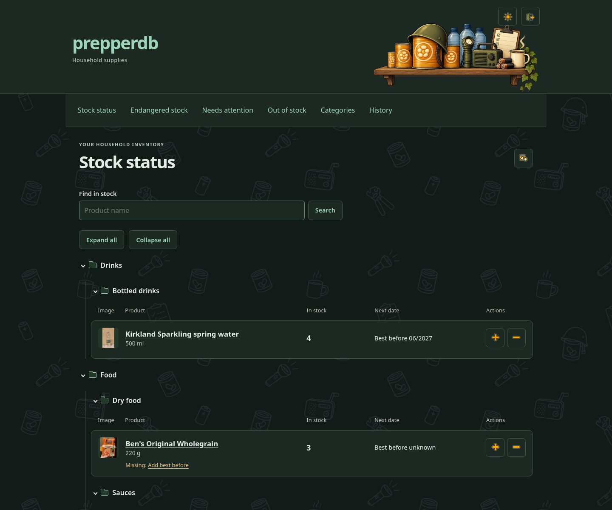
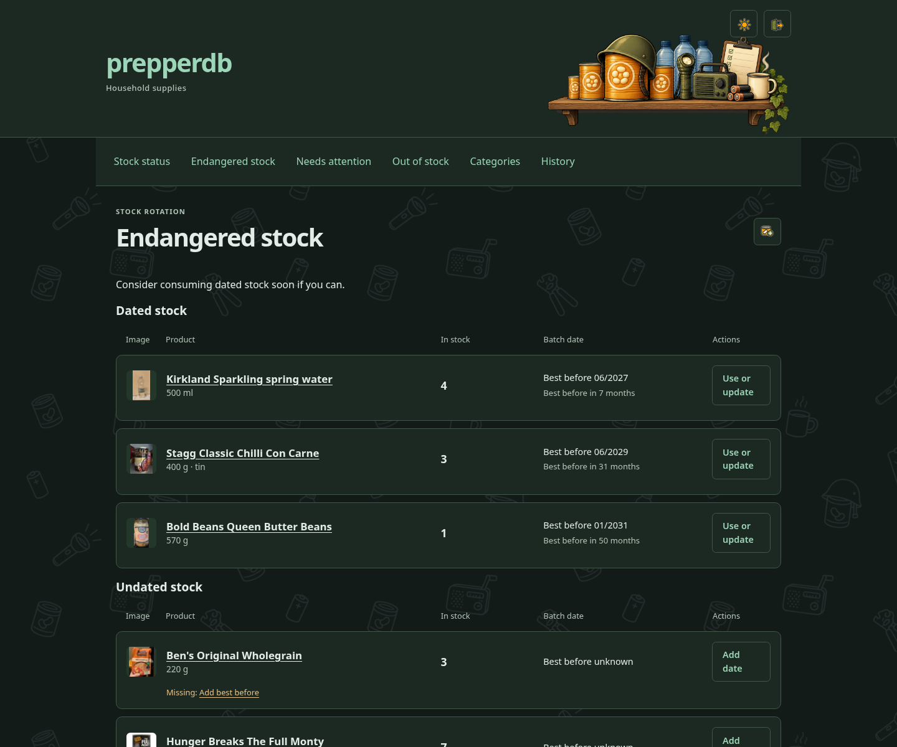
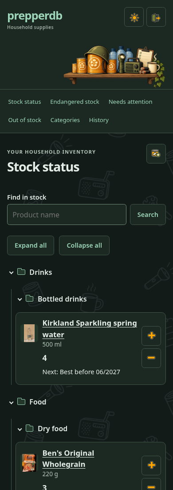

# PrepperDB

A small, self-hosted app for keeping track of household supplies and using them before they go to waste. Add a few tins, record quantities and dates, and see what needs using next. A name and quantity are enough to get started; fill in the other details later.

**v0.1** is the first public release. PrepperDB was developed using AI coding tools under its owner's direction. Suggestions, human-written patches and AI-generated contributions are all welcome. No AI service, subscription or API key is needed to run it.

[Getting started](docs/getting-started.md) · [User guide](docs/user-guide.md) · [Deployment](docs/deployment.md) · [HTTPS](docs/https.md) · [Contributing](CONTRIBUTING.md)

## What it does

- **Stock status:** quantities, photos, categories and quick add/use controls.
- **Endangered stock:** dated supplies in the order you should consider using them, with undated items shown separately.
- **Needs attention:** missing dates, sizes, photos or categories, with links to fix them.
- **Out of stock:** keep familiar products ready for replenishment.
- Barcode/name lookup through Open Food Facts, plus locally bundled camera and photo barcode decoding.
- Manual entry and stock management work without internet access after installation.
- Quantities, multipacks, best-before/use-by dates, editable category trees, photo upload/crop/rotation, dark/light themes and 32-day change history with Undo.
- Local accounts and passwords; no public registration, email service or external sign-in.

## Screenshots

These app-only screenshots show the current household installation; browser controls and its hostname are omitted. Bundled artwork and icons are included in the source and release archives.







## Try it locally

Use **Python 3.13**. The tested platform and hash-locked wheels are Linux x86-64; see [getting started](docs/getting-started.md) for prerequisites and other platforms.

From a downloaded/extracted release or Git checkout:

```sh
python3.13 -m venv .venv
. .venv/bin/activate
python -m pip install --require-hashes -r requirements.lock
export PREPPERDB_DEVELOPMENT=1
python manage.py migrate --noinput
python manage.py user_account alex
python manage.py runserver 127.0.0.1:8000 --noreload --insecure
```

Open **http://127.0.0.1:8000/** and sign in with the account you just created. The account command prompts privately for a password; there is no default password. This local preview uses a development-only key and must remain bound to loopback. Use the [deployment guide](docs/deployment.md) for a permanent or LAN installation.

## Is it right for you?

PrepperDB uses **Django, SQLite and one Waitress process** behind nginx. There is no separate database server, Redis, Node runtime or frontend build step.

**SQLite is intended for one household with light concurrent use.** Several accounts can share the app, but **every account sees and can change the same inventory**. There are no private inventories, roles or tenant boundaries. SQLite permits one writer at a time: a few occasional users are different from a busy multiuser service. High write concurrency, multiple application replicas and network-mounted database files are outside v0.1's supported design. PostgreSQL is not a drop-in supported option. [Details and limits](docs/operations.md#sqlite-and-multiple-users).

**HTTPS is recommended, but optional.** Production defaults to HTTPS; set `PREPPERDB_HTTPS=0` to choose HTTP explicitly. HTTP exposes credentials and sessions to network observers, and phone-camera scanning normally needs a trusted HTTPS origin (localhost is a browser exception). Manual entry and photo barcode decoding remain available. [Choose and configure HTTP or HTTPS](docs/https.md).

The app records dates; it does not determine whether food is safe to eat. Best-before and use-by labels remain distinct. Nothing is automatically discarded because a date passes.

## Contributions, assets and maintenance

Read [CONTRIBUTING.md](CONTRIBUTING.md) for reporting bugs, proposing changes and running tests. AI-generated contributions are welcome when the contributor understands the change, explains it and reports actual test results.

[Third-party notices](THIRD_PARTY_NOTICES.md) cover bundled barcode libraries and optionally imported product data/photos. Product photos in a running instance are not shipped as a starter database. See [release notes](CHANGELOG.md) and [backup/upgrade guidance](docs/operations.md).
